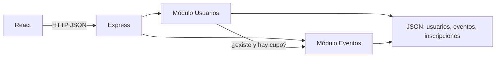

# EventIA

Primera versión de una plataforma para publicar eventos, descubrirlos e inscribirse con control de cupo.

## 1. Definición del MVP

### Incluimos en el MVP

- Registro de usuarios, con inicio de sesión mínimo para saber quién publica y quién se inscribe
- Publicación de eventos
- Consulta y búsqueda de eventos
- Inscripción a eventos
- Control de cupos
- Consulta de las inscripciones realizadas
- Modificación y eliminación básicas, porque forman parte de las responsabilidades de cada módulo y evitan datos que no se pueden corregir

Cada una quedó en su versión mínima: formularios cortos, búsqueda por texto y un cupo numérico. No hay perfiles avanzados, pagos ni recomendaciones.

### Dejamos para después

- Notificación de confirmación

La notificación no decide si la plataforma sirve. La persona ya ve en pantalla que la inscripción quedó hecha y puede consultarla después. Un correo o un push añade un servicio externo, credenciales y fallos de entrega que el equipo todavía no necesita para validar el uso.

### Justificación

El valor de esta versión es un ciclo completo: alguien publica una actividad, otra persona la encuentra, aparta un lugar y el cupo deja de ofrecer ese lugar. Si falta cualquiera de esos pasos, el producto no se puede probar con usuarios reales. La confirmación en pantalla cubre el cierre del ciclo mientras se aprende si la gente vuelve.

## 2. Arquitectura

### Arquitectura seleccionada

Monolito modular.

El equipo es pequeño y la meta es validar uso, no sostener millones de personas. Un solo proceso Express se despliega y se entiende fácil. Los módulos tienen fronteras claras para poder separarlos más adelante si el producto crece. Microservicios, colas y bases distribuidas sobran en esta etapa.

### Módulos

**Usuarios**

- Crear, modificar y eliminar usuarios
- Iniciar sesión
- Inscribir a un evento
- Consultar las inscripciones propias

**Eventos**

- Crear, modificar y eliminar eventos
- Consultar y buscar
- Calcular el cupo disponible

La inscripción vive en Usuarios porque es una acción de la persona. El cálculo del cupo vive en Eventos porque el cupo es un dato del evento. Ninguno importa el código del otro: `src/composition.js` les inyecta funciones pequeñas.

### Relaciones

- Un usuario puede publicar varios eventos.
- Un usuario puede inscribirse a varios eventos.
- Un evento tiene un organizador y muchas inscripciones, sin repetir a la misma persona.

### Almacenamiento

Un archivo JSON local (`apps/api/data/db.json`) con tres colecciones:

- `usuarios`
- `eventos`
- `inscripciones`

Hace falta guardar las tres. Con solo usuarios no se pueden buscar actividades ni restar lugares. Los repositorios esconden el archivo, así que más adelante se puede cambiar por una base de datos sin reescribir las reglas.

### Comunicaciones

- El navegador React habla con Express por HTTP y JSON en `/api`.
- Entre módulos la comunicación es una llamada de función en el mismo proceso.
- No hay correo, cola ni red interna. La confirmación de la inscripción es la respuesta HTTP y la pantalla.



## 3. Dependencias

| Componente | Se relaciona con | ¿Qué necesita? |
| --- | --- | --- |
| Usuarios, al inscribir | Eventos | Que el evento exista, que haya cupo disponible y que esa persona no esté ya inscrita |
| Eventos, al publicar o editar | Usuarios | Que el organizador exista y sea quien inició sesión |
| Usuarios, al consultar inscripciones | Eventos | Título, fecha, lugar y cupo restante de cada evento |
| Eventos, al calcular cupo | Inscripciones | Cuántas inscripciones activas tiene ese evento, por el puerto `contarInscripciones` |

Eventos no administra las inscripciones. Solo pregunta cuántas hay y aplica `cupo - inscritos`. Así la responsabilidad queda en un solo lugar y no se forma un ciclo de imports.

## Cómo correrlo

Requiere Node 18 o superior y pnpm.

```bash
pnpm install
pnpm test
pnpm dev
```

Abre http://localhost:5173. La API queda en http://localhost:3001.

Cuentas de demostración, contraseña `demo1234`:

- `ana@eventia.dev`
- `luis@eventia.dev`

Flujo para comprobar el cupo: entra como Ana, abre **Cine al aire libre** (queda 1 lugar), inscríbete y confirma que el cupo pasa a agotado. En **Mis inscripciones** aparece ese evento.

## Dónde se ve la arquitectura en el código

```text
apps/api/src/modules/usuarios   registro, sesión, inscripción
apps/api/src/modules/eventos    publicación, búsqueda, cálculo de cupo
apps/api/src/composition.js     conexiones entre módulos
apps/api/src/shared/store.js    almacenamiento
apps/web                        interfaz React
```
