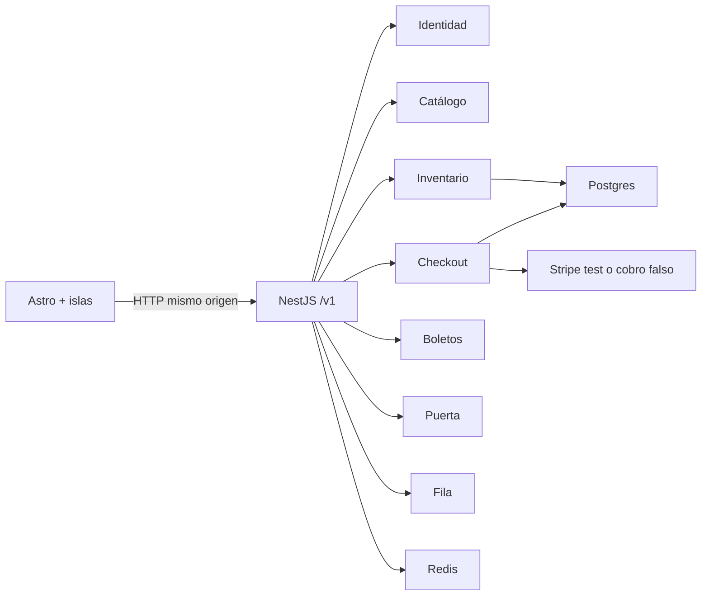

# Arquitectura

Monolito modular. Un proceso NestJS y una app Astro. Los módulos no se importan las reglas entre sí: cada uno habla con Prisma o con un servicio de infraestructura.

## Cupo

El lugar no se reserva en la aplicación y luego se confirma. Un solo `UPDATE` incrementa `held` si `sold + held + cantidad <= capacity`. Un `CHECK` en la zona es el respaldo. La versión de la fila sube, pero no entra en el `WHERE`: bajo contención un versionado optimista rechazaba apartados que sí cabían.

El apartado dura 8 minutos. Al pagar, `held` pasa a `sold` dentro de la misma transacción que crea la orden y los boletos. La orden es única por apartado y la clave de idempotencia es única por persona. Repetir la misma clave devuelve el mismo recurso. Cambiar el cuerpo con la misma clave responde 409.

## Pase

El QR no lleva un secreto. El servidor firma con Ed25519 un token de 30 segundos (`tid`, `sid`, `rev`, `kid`, ventana). Transferir o reembolsar sube `rev`, así que una captura vieja queda revocada. En la puerta, un índice único permite un solo check-in `OK` por boleto.

El manifiesto firmado (`GET /v1/checkin/manifest/:sessionId`) deja la puerta operar sin red: el navegador verifica la firma y la revisión, guarda el pase en IndexedDB y luego lo concilia.

## Fila

Si la venta aún no abre, cada cuenta recibe una posición al azar. Cuando abre, el orden es el de llegada y un advisory lock evita dos posiciones iguales. El apartado de una función con fila exige el JWT de admisión.

## Datos

Organización (pendiente, activa o suspendida), sede, evento, función, zona, asiento, tipo de boleto, apartado, orden, boleto, transferencia, reembolso, lista de espera, check-in, bitácora encadenada por hash y entrada de fila. El rol ADMIN opera el panel de plataforma. Una cuenta puede quedar suspendida. El esquema y las políticas RLS de lectura y escritura por `app.org_id` están en la migración inicial. El rol de desarrollo es superusuario, así que RLS no se aplica hasta usar un rol que no sea dueño. No está forzado: forzarlo sin `set_config` tumbaría la API.

La moneda de cobro es USD. Stripe no cobra en GTQ; el precio se muestra en dólares a propósito.

## Seguridad en el borde

Argon2id, access JWT de 10 minutos solo en memoria, refresh opaco rotativo en cookie `httpOnly` con ruta `/v1/auth`, CSRF de doble envío, helmet, límite de cuerpo 100 kb, problemas en `application/problem+json`, bloqueo tras 5 fallos de login y Swagger fuera de producción. El usuario de la petición sale de la base, no de un id enviado por el cliente.
